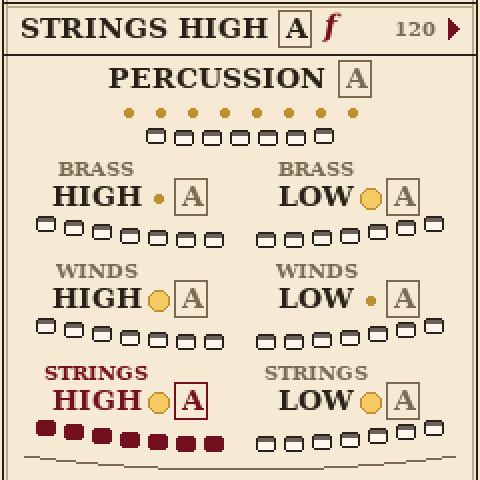
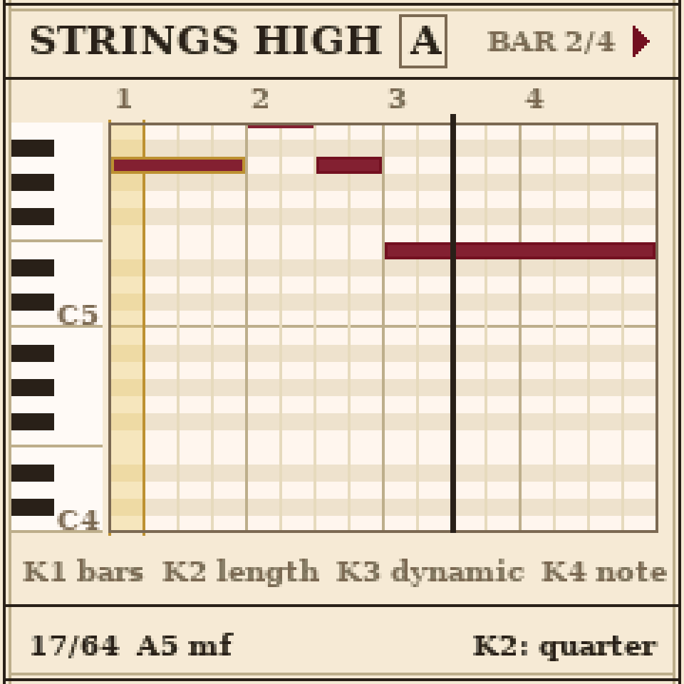
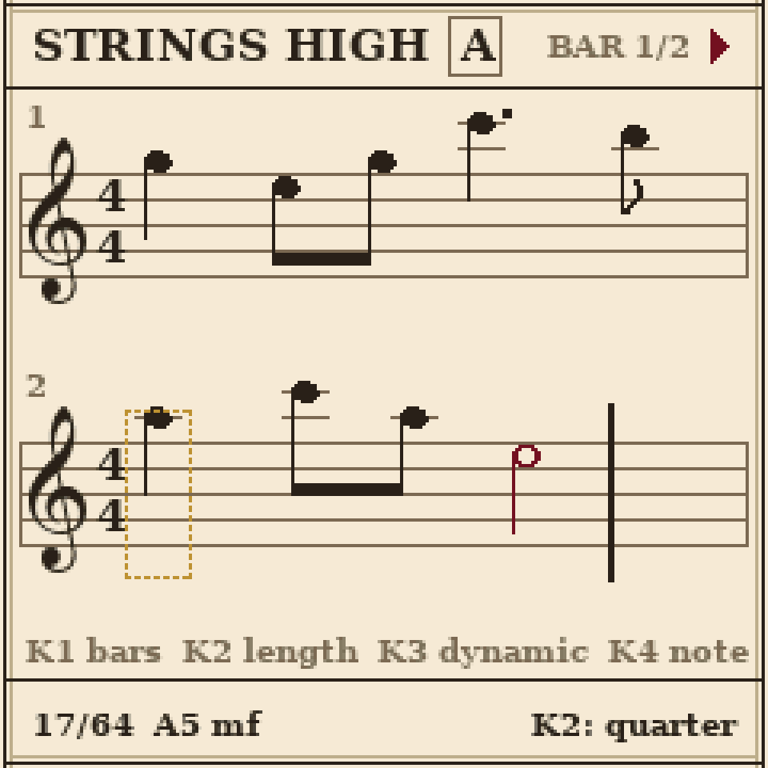
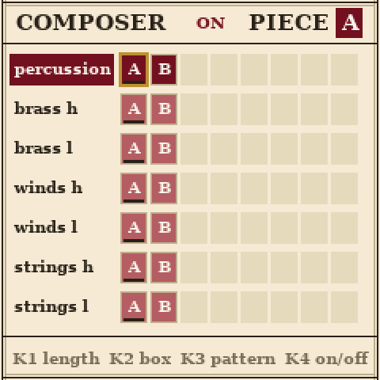

# CONDUCTOR

**A pocket orchestra for the M-VAVE FM-1: you are the composer, the musician and the *conductor*.**

CONDUCTOR turns the FM-1 into a small symphony orchestra: strings, woodwinds, brass and percussion. Write parts, shape
how they play, chain the patterns into a piece and hear it all in a concert hall.

**[Read the user guide](https://mammothcheese.github.io/conductor/)** for every page and control, with pictures.

<p align="center">
  
  
  
  
</p>

Press **PLAY** as soon as it starts: a short overture is loaded to show what it can do. It is also in **SAVE 1**, so
you can load it again later (until you save something of your own there).

## The orchestra

The sections sit as the conductor sees them: strings at the front, woodwinds behind, then brass, and percussion at the
back.

| Section | High | Low |
| --- | --- | --- |
| Strings | violins | cellos |
| Woodwinds | oboes | bassoons |
| Brass | trumpets | horns |
| Percussion | eight drums of your choice: bass drum, cymbals, triangle, snares, toms, timpani | |

Every melodic part plays up to three notes at a time, *tutti* (the whole section), *solo* (one player) or *tacet*
(silent). The string, wind and brass sounds were measured from recordings of real instruments.

## What it does

- **Ten patterns per part, A to J**, written on a piano roll or as sheet music, or recorded as you play.
- **Articulations**: *staccato*, accent, *legato*, *marcato*, trill, and *pizzicato* and *tremolo* for the strings.
- **Expression and balance**: how strongly a section plays (*pp* to *ff*, changing its tone), and where it sits in
  the mix. Each pattern can carry a *crescendo* or *diminuendo* curve, drawn or performed.
- **Per-pattern settings**: each pattern keeps its own expression, players, vibrato, balance and *con sordino*.
- **The Composer**: chain patterns into a piece, ten pieces A to J. Hold **SEQ** while playing for *Fine - fermata*.
- **Time signatures** 2/2, 3/8, 2/4, 3/4, 6/8, 4/4, 5/4 and 12/8; **swing**, **humanise** and **tap tempo**.
- **Key**: key signatures in the notation, moving the music to a new key, scale lock and lit keys.
- **The hall**: studio, chamber, concert hall or cathedral; a **metronome** with count-in.
- **Four save slots**, **MIDI in** over USB or the TRS jack, and the FM-1 as a **USB audio** input.

## Quick start

| Button | Does |
| --- | --- |
| **PLAY** | start and stop |
| **SELECT** | choose a section (on the orchestra page) |
| **KNOB 1-4** | the section's expression, balance, live transpose, and the tempo |
| **FX / SEL / ENV** | a part's page: strings, woodwinds, brass |
| **LFO** | the percussion's drum machine |
| **EDIT** | the chosen part's pattern: piano roll, music, expression curve |
| **PRESETS** | the part's pattern, A to J |
| **ARP** | *tutti*, *solo*, *tacet* (hold: hear that part alone) |
| **SEQ** | the Composer |
| **GLO** | MIX, then the piece page, then the KEY page |
| **REC** | record as you play (hold, then again: clear everything) |
| **SAVE** | the four save slots |
| **HOME** | back to the orchestra |

The bottom line of each page says what its knobs and buttons do. The [guide](https://mammothcheese.github.io/conductor/)
has the full list.

## Install

Download the `.fwsc` from [Releases](https://github.com/MammothCheese/conductor/releases), or build it on GitHub
(Actions, `release.yml`) or on Linux (see [docs/DINGHY.md](docs/DINGHY.md)). Install it with **M-Flasher** (back up the
whole flash first) or `python tools/fm1_install.py build/conductor.fwsc`. The FM-1 then reports itself as `FM-1_1812`
(CONDUCTOR).

**USB rescue:** hold **OCT-** while switching on, then install again. **Going back:** restore your M-Flasher backup, or
install M-VAVE's official `FM-1.fwsc`.

## Try it on a PC

```sh
sh run_host.sh                                  # build/host/conductor.wav + screens as PNG
sh run_host.sh tests/scripts/conductor_edit.txt
```

## Credits and licence

GPL-3.0-only. Built on [Dinghy](https://github.com/zvenson/dinghy) (designburg), on the platform of
[Felucca](https://github.com/hugelton/Felucca) by Leo Kuroshita (Hügelton Instruments), as
[SLOOP](https://github.com/isod89/sloop-fm1) (isod89) carries it; the SMK-37 layer is genkigenki's. See
[LICENSING.md](LICENSING.md). The lettering is DejaVu Serif Bold, rendered into the firmware by `tools/gen_serif.py`
(Bitstream Vera licence: [firmware/gen/DEJAVU-LICENSE.txt](firmware/gen/DEJAVU-LICENSE.txt)). The music symbols
(clefs, rests, flat, natural) are Noto Music's, drawn by `tools/music2c.py` (SIL OFL 1.1:
[assets/fonts/NotoMusic-LICENSE.txt](assets/fonts/NotoMusic-LICENSE.txt)); the notation code comes from QUARTET.
Dinghy's own documentation is in [docs/DINGHY.md](docs/DINGHY.md), the platform API in [docs/API.md](docs/API.md).

Installing firmware is at your own risk. CONDUCTOR is not made or endorsed by M-VAVE.
